<!--
  BEFORE PUBLISHING: these 7 repos are linked below but are still PRIVATE.
  Make each one public first, or the links 404 for every visitor:
    - Fix-Seb/france-2018-passing-networks
    - Fix-Seb/music-and-mental-health
    - Fix-Seb/matchawerk-berlin
    - Fix-Seb/humanoid-robot-conjoint
    - Fix-Seb/eu-rail-satisfaction
    - Fix-Seb/operation-mercurio
    - Fix-Seb/facebook-vaccine-ads-replication
  Website shows "coming soon" (no link yet): add the URL once the site is live.
-->

  <picture>
    <source media="(prefers-color-scheme: dark)" srcset="assets/portrait-dark.svg">
    <source media="(prefers-color-scheme: light)" srcset="assets/portrait-light.svg">
    
  </picture>
  <picture>
    <source media="(prefers-color-scheme: dark)" srcset="assets/neofetch-dark.svg">
    <source media="(prefers-color-scheme: light)" srcset="assets/neofetch-light.svg">
    
  </picture>

<h3 align="center">Every process is a people problem. I build the tech that fixes it.</h3>

I get hired for one problem. The real fix usually sits underneath: **data nobody trusts, tools that don't talk, a process built for the process**.
So I take one step back to go five forward: a quick fix, then something structural.
People judge and decide. **The system brings the right information to the right place.**

## Selected work

No repos here: company code stays with the company.

| Client | Result |
|:--|:--|
| **Earlybird Health** | HealthOS: an AI-native decision layer on the CRM that runs the deal flow, so partners can judge. |
| **marta** | From lead to hired caregiver in a few clicks. Onboarding went from 30 minutes to 2. |
| **adidas** | From 8 clicks and 40 pages per contract to one button, at about 90% accuracy. |
| **Henkel** | Five questions to ask before an outside factor enters the forecast. With [Moritz von Buchwaldt](https://www.linkedin.com/in/moritz-von-buchwaldt-120592190/). |
| **FORMEL Skin** | The C-level's first live view of retention. Where it all started. |

## Research

Coursework from the MSc at ESMT. Real results, including the null ones.

| Project | Finding |
|:--|:--|
| **[When the Patrols Leave](https://github.com/Fix-Seb/operation-mercurio)** going public soon | A raid in the Amazon cut net gold-mining additions from 1,640 to 163 ha/yr, while mining rose across the highway. With Ruby Ann Grambauer, Laurens van der Lely, Omkar Mate, Dhruv Chaudhari. |
| **[Facebook Ads and Vaccines](https://github.com/Fix-Seb/facebook-vaccine-ads-replication)** going public soon | Replicated Ho et al. (2023) on 1,213 US counties: every arm is null once the real treatment labels are used. With Dávid Szabó-Zsiga, Georgij Backhaus, Sabrina Mendes Braga. |
| **[MatchaWerk Berlin](https://github.com/Fix-Seb/matchawerk-berlin)** going public soon | Arkonaplatz stays top-10 in 98% of 10,000 weightings. Friedrichshain-Kreuzberg is saturated. With Shengyuan Yang, Lakshmi Likitha Y K, Yen Hsi Lo. |
| **[Humanoid Robot Conjoint](https://github.com/Fix-Seb/humanoid-robot-conjoint)** going public soon | The full task suite is worth €376/month over cleaning-only, yet 65% would buy none of the configurations. With Georgij Backhaus, Laurens van der Lely, Lenny Blieffert, Linus Olsson, Ruby Ann Grambauer. |
| **[The Squeezed Middle](https://github.com/Fix-Seb/eu-rail-satisfaction)** going public soon | Only the Business Elite among rail passengers is mostly satisfied (85%). Boarding drives it (held-out AUC 0.91). With Dávid Szabó-Zsiga, Georgij Backhaus, Sabrina Mendes Braga. |
| **[France 2018 Passing Networks](https://github.com/Fix-Seb/france-2018-passing-networks)** going public soon | Being central in the passing network didn't reliably predict chance creation. The one naive link fails after correction. Solo. |
| **[Music and Mental Health](https://github.com/Fix-Seb/music-and-mental-health)** going public soon | Listening 0–2 h a day went with the least distress. Favourite genre explained under 2% of it. With Shengyuan Yang, Yen Hsi Lo, Lakshmi Likitha Yenuga Krishnareddygari. |
| **Ethical AI variable checker** no repo yet | Which variables may a sector's classification model ethically use? Analytics & Society. |

## Stack

| Area | Tools |
|:--|:--|
| **Build** | Python, Supabase, Git. **Claude Code**, fluently: I build my own mods and custom skills, and extend or work around the native ones. |
| **Data** | pandas, NumPy, SciPy, scikit-learn, R (tidyverse, igraph), NetworkX, Matplotlib, Seaborn |
| **AI** | LLM APIs, NLP (spaCy, NLTK). Deterministic first; a model only where judgement is needed. |
| **Ops** | n8n, Google Cloud, Azure, Power BI, and yes, still Microsoft Office |

## How I work

1. **Every process is a people problem.** I start with who's in the loop and what they need.
2. **Fewer agents, better processes.** Most workflows are deterministic. AI goes where judgement is needed, not everywhere.
3. **Go where the friction is.** Change is hard. That's where the value hides.
4. **Ask until they find it.** Three, four, five questions. Usually people find the answer themselves.
5. **High standards, ship early.** 110% on what matters, then real users tell me what's next.

## Say hi

**Got a process that slows your people down?** [LinkedIn](https://www.linkedin.com/in/sebastian-florian-schmid/) · [sebastian.schmid@whu.edu](mailto:sebastian.schmid@whu.edu) · website coming soon
